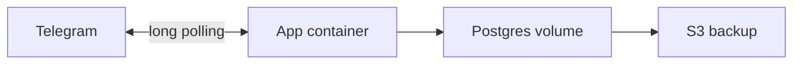

# План размещения на одном сервере

Документ на время после проверки базы из [db-review.md](db-review.md).
Сервер по нему пока не арендуется, Dockerfile и production-compose в репозитории ещё нет.
Схема, флаги и живые заявки этим планом не меняются.

## Что уже запущено локально

`docker-compose.yml` поднимает только PostgreSQL 18. Порт опубликован на `127.0.0.1`, данные лежат в томе `postgres_data`.

Приложение — один процесс Node.js (`src/index.ts`): HTTP с `GET /health`, Telegram-бот long polling и два worker (статусы обменов и outbox уведомлений).
Отдельного образа приложения нет. Redis, входящий webhook статусов и Telegram Mini App в этот этап не входят.

Вторая копия процесса недопустима: два клиента long polling с одним токеном бота конфликтуют.
Захват строк worker-ом (`FOR UPDATE SKIP LOCKED` и сдвиг `next_check_at`) не заменяет это правило и вторую копию с тем же токеном не разрешает.

## Целевая схема

Одна арендованная машина и Docker Compose из двух контейнеров:

- Postgres 18, тот же мажор, что локально, без опубликованного наружу порта;
- приложение на Node.js >= 22.18, одна реплика, health слушает только сеть Compose.

Балансировщик, отдельный RDS и несколько машин для бота с исходящим опросом Telegram не нужны.
Amazon здесь — обычная виртуалка, не набор управляемых сервисов.

## Сервер

Ориентир: 2 vCPU, 4 ГБ RAM, 40–80 ГБ SSD.

У Amazon этому соответствует Lightsail с 4 ГБ RAM либо EC2 `t4g.medium` (2 vCPU, 4 ГБ).
Регион — ближе к пользователям бота. Сам сервер порядка 15–40 USD в месяц; снимки диска и выгрузка бэкапов считаются отдельно и стоят меньше.

Покупать машину имеет смысл после замечаний по базе. До этого сервер будет простаивать.

На машине: Docker Engine и Docker Compose v2, пользователь для деплоя без ежедневной работы из-под root, часовой пояс UTC.

## Секреты и первый запуск

Секреты лежат только в `.env` на сервере, права `600`, владелец — пользователь деплоя.
В образ и в git файл не попадает. Нужны как минимум `DATABASE_URL`, `TELEGRAM_BOT_TOKEN`, `CHANGENOW_API_KEY`, параметры `POSTGRES_*` для контейнера базы.
Пароль в URL кодируется, если в нём есть спецсимволы.

На первом запуске `CHANGENOW_ENABLED` и `PRIVATE_TRANSFER_ENABLED` остаются `false`.
Пустое значение флаги тоже выключает. Живой режим включается вручную, когда база проверена, дамп восстанавливается и процесс уже крутится на сервере.
Включённый обмен без ключа процесс не стартует и на мок молча не переключается.

Порядок старта:

1. Поднять контейнер Postgres и дождаться healthcheck.
2. Выполнить `prisma migrate deploy` от того же `DATABASE_URL`. Ручной SQL миграций приезжает вместе с ними, отдельно его не накатывают.
3. Запустить ровно один контейнер приложения.

Обновление версии: собрать новый образ и пересоздать этот контейнер. Второй экземпляр рядом не поднимать.
Остановка по `SIGTERM` уже обрабатывается: процесс закрывает бота, worker-ы и соединение с базой в пределах `SHUTDOWN_TIMEOUT_MS`.

## Сеть

Снаружи открыт SSH и только с IP администратора.
Порт 5432 на сетевой карте сервера закрыт, публикация `ports` у Postgres в production-compose не нужна: приложение ходит к базе по имени сервиса в сети Compose.

Входящий HTTPS для long polling не требуется: бот сам устанавливает исходящее соединение с Telegram.
`/health` остаётся внутри Docker-сети. Страница виджета `GET /widget` отдаётся тем же процессом.
Страница `GET /widget` содержит рамку виджета и скрипт следующего шага.
Кнопка меню открывает эту страницу в браузере. Прямой адрес `widget.html` оставляет обмен на первом экране.
Webhook статусов по-прежнему ждёт отдельного решения.

## Бэкап

Ежедневный `pg_dump` в каталог на диске сервера и копия в объектное хранилище S3.
Дамп custom-формата, срок хранения на диске — несколько последних копий, в S3 — дольше.

До включения живых заявок один дамп нужно поднять на чистой базе и убедиться, что миграции и CHECK на месте.
Том Docker — не замена дампу: снимок диска полезен, но восстановление проверяют именно файлом `pg_dump`.

## Наблюдение

Живость процесса — `GET /health`: ответ `200` и `database: up`, иначе `503`.
Логи — stdout контейнера (Pino). Ключи, токен бота и приватные данные в логи не пишутся.
Отдельный сборщик метрик можно добавить позже, для первого сервера достаточно health и логов.

## Что остаётся следующим шагом

После проверки базы, отдельной задачей:

- `Dockerfile` приложения (сборка TypeScript, `prisma generate`, запуск `node dist/index.js`);
- production `docker-compose` с Postgres без внешнего порта и одной репликой приложения;
- сценарий бэкапа и проверка восстановления.

Пока этих файлов в репозитории нет, текущий `docker-compose.yml` остаётся локальным Postgres для разработки.
